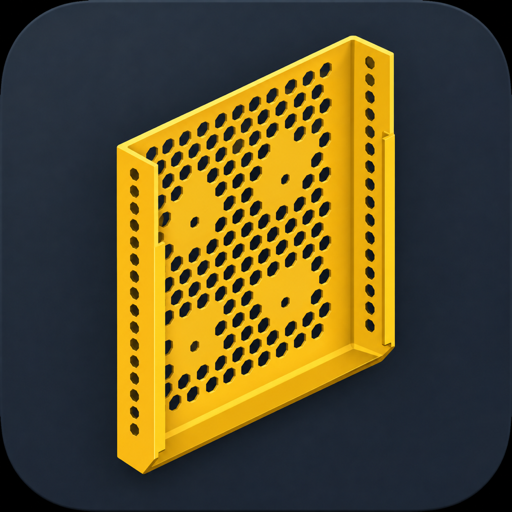
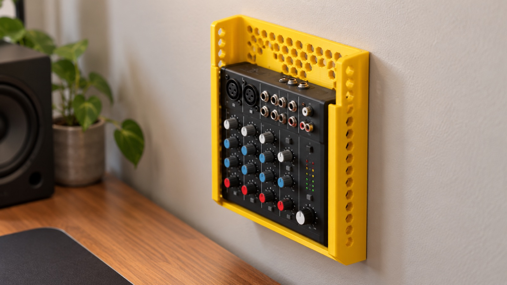
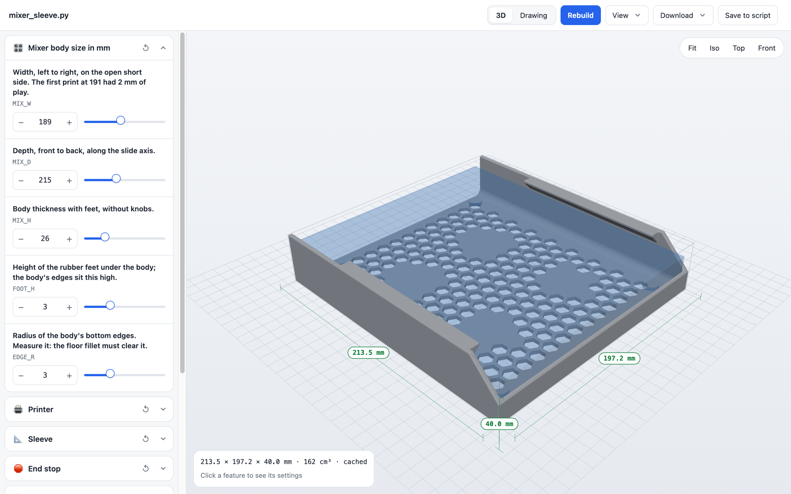
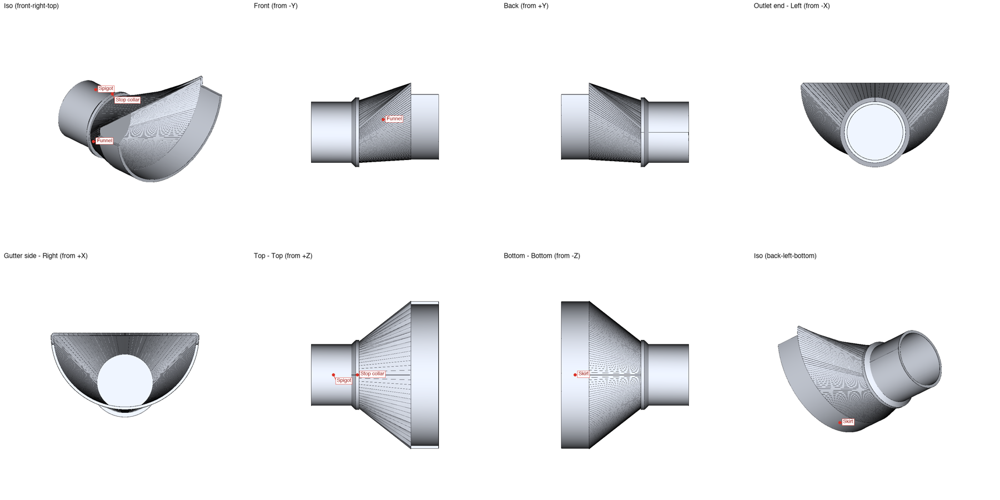
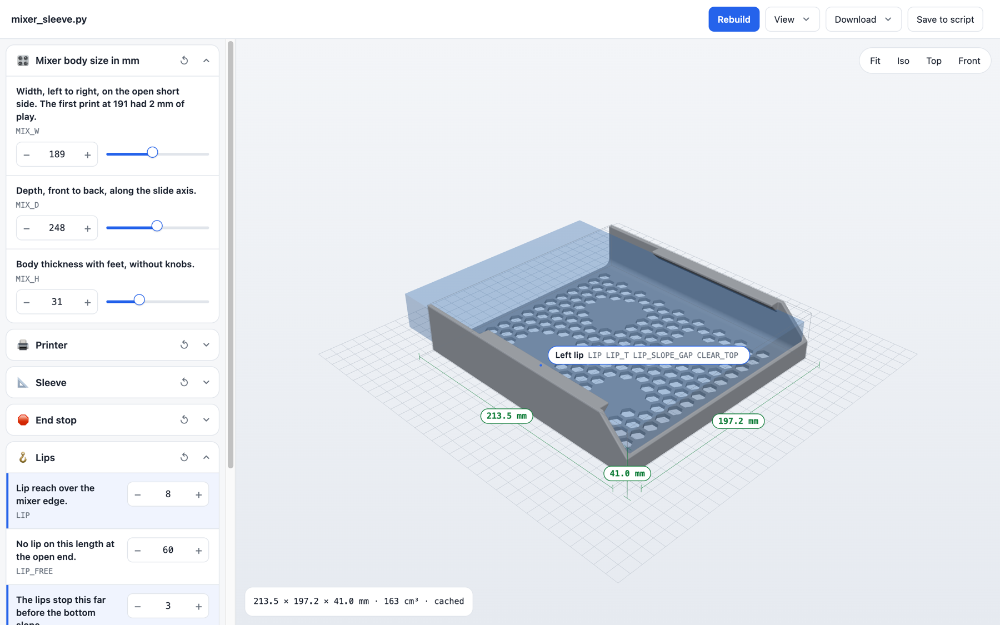

<p align="center">
  
</p>

<h1 align="center">PrintForge</h1>

<p align="center">
  Design 3D-printable parts by talking about them.
</p>

<p align="center">
  
  
  
  
</p>

PrintForge is a Claude skill for designing holders, sleeves, mounts, brackets and
enclosures you can 3D print. Describe the part, or send a photo of the device it
has to hold. Claude writes a parametric CadQuery model, exports a STEP and a
print-ready STL, and renders labeled views of every side. Then you change it
the way you would with a friend at the workbench: *"make the lip 8 mm"*,
*"remove the lip from the top 6 cm"*, *"optimize for a 0.4 nozzle"*.

<p align="center">
  
</p>

<p align="center"><sub>Illustration generated from the real model. The renders below come straight from the CAD file.</sub></p>

<p align="center">
  
</p>

<p align="center"><sub>The live configurator. Change the device, the shell follows.</sub></p>

## Why PrintForge exists

Asking an AI for an STL usually ends in a mesh you can't change and a
conversation where "the left side" means something different to each of you.
PrintForge fixes both. Every number in the part is one named parameter in a
small Python script, every side and feature has a name that shows up in the
renders, and every change is rebuilt and checked before you see it. You stay in
charge of the design, and you can rebuild it yourself with one command.

## Highlights

- Plain-language changes to walls, lips, holes, vents, fillets and fits
- Named sides and features (*Left lip*, *Lip-free zone*, *Mount mark M1*) shown as tags in every view
- Labeled orthographic and isometric renders after every rebuild, so you inspect the part before you slice it
- Printer-aware sizes: walls and plates are whole numbers of extrusion lines and layers for your nozzle and layer height
- Print-ready STL in the print orientation, plus an editable STEP for Fusion, FreeCAD or Onshape
- A Bambu Studio / OrcaSlicer 3MF with the recommended layer height, walls and infill already set, checked by slicing it headless
- Always `uv` and CadQuery: no conda, no global installs, reproducible builds
- A growing list of CadQuery pitfalls the skill already knows how to avoid

## Examples

| Project | What it is | Device it fits | Live |
|---|---|---|---|
| [`projects/mixer-sleeve`](./projects/mixer-sleeve) | Wall sleeve with lips, hex vents and a low end stop | Behringer Xenyx 1002SFX mixer, 189 × 248 × 31 mm | `uv run mixer_sleeve.py --serve` |
| [`projects/gutter-outlet`](./projects/gutter-outlet) | Outlet funnel from a half-round gutter to a round downpipe, no inner lip anywhere | NW 280 gutter, 127 mm inside, to a 58 mm pipe | `uv run gutter_outlet.py --serve` |

Each project is a folder with the model script, the STEP, the print-ready STL
and 3MF, labeled views and a README. Every one has a launcher in
`.claude/launch.json` that opens its configurator in the Claude browser pane.

<p align="center">
  
</p>

## Showcase: mixer sleeve

[`projects/mixer-sleeve`](./projects/mixer-sleeve) was designed in one
conversation, starting from a photo of the label on a Behringer Xenyx 1002SFX
mixer. The sleeve screws to an existing wall mount, and the mixer drops in from
the top.

<p align="center">
  
</p>

How it evolved, one plain-language request at a time:

| Request | What changed in the model |
|---|---|
| "Give me a sketch first" | Inline sketch with named sides before any CAD |
| "Rounded inner edges, smaller top flange" | 4 mm inside fillets, 3 mm lip |
| "The opening should be on the short side" | Slide axis swapped to the mixer's depth |
| "Sides should have openings for heat" | Hex vents on the back, side walls and end stop |
| "It's 2.5 cm thick" | Body thickness corrected from the spec sheet's 5 cm (knobs included) |
| "Remove the inserts, keep a small indicator" | Bosses replaced by 0.84 mm marks in solid pads |
| "4 mm narrower so it grips tightly" | Inside width 196 → 192 mm |
| "Lip 8 mm, filled at 45° so it prints" | 45° fill under each lip, prints flat without supports |
| "Make the end stop lower, the mixer is curved there" | End stop 16 mm with a 45° slope to the walls |
| "Optimize for a 0.4 nozzle, 0.28 layers" | Thicknesses tied to `LINE` and `LAYER` counts |
| "Faster print time?" | Thinner back plate, lower walls, 11.5 mm back vents |
| "Generate a 3MF with recommended parameters" | Print-ready 3MF, sliced headless to check: 110 layers, ~3 h, 127 g |
| "The wall is not high enough, needs to be 5 cm" | Walls 50 mm, a named `WALL_H` setting |
| "Narrow it, the mixer slides left and right" | Inside width 192 → 190 mm |
| "After printing the side broke off" | Side vents removed, 3.6 mm walls, 6 mm floor fillet, 45° gussets outside each wall |
| "Remove these legs" | Gussets behind a `GUSSETS` switch, off |
| "Make the viewer interactive" | Click a feature in the configurator and its settings light up on the left |
| "MakerWorld has this toggle that shows dimensions" | Dimensions toggle: bounding box with the three sizes on the part |

Every row was rebuilt, rendered and checked as a single solid before it was sent.

## How It Works

1. Describe the part, or attach a photo of the device it holds.
2. Claude asks for the real measurements, mount, nozzle, layer height and wall loops.
3. It writes a parametric CadQuery script and builds it with `uv`.
4. It renders labeled views, checks them, and sends you the views, STL and STEP.
5. It writes a 3MF with the recommended print settings for your printer, slices it to check, and tells you the time and grams.
6. You ask for changes by name. Claude edits one or two parameters and repeats.

## Install

**Claude Code**

```bash
git clone https://github.com/dz0ny/printforge.git
mkdir -p ~/.claude/skills
cp -R printforge/skills/cad-print-design ~/.claude/skills/
```

Start a new Claude Code session and ask for a part. The skill loads by itself
when you mention an STL, a 3D print, or a holder for a device.

**Claude apps**

Download [`dist/cad-print-design.skill`](./dist/cad-print-design.skill) and
add it to your skills in Claude.

## Requirements

- [Claude Code](https://code.claude.com/docs) or a Claude app with skills enabled
- [uv](https://docs.astral.sh/uv/) on your path. It installs CadQuery and its
  OpenCascade kernel from wheels on first use. No conda is needed.
- A slicer for the STL, for example Bambu Studio, OrcaSlicer or PrusaSlicer

## Rebuild the example yourself

```bash
cd printforge/projects/mixer-sleeve
uv run mixer_sleeve.py
uv run render_views.py mixer_sleeve.step --labels labels.json --out views
uv run make_3mf.py mixer_sleeve.stl --settings print_settings.json \
  --template bambu_p1s_0.4.config --out mixer_sleeve.3mf
```

Or skip the build and open [`mixer_sleeve.3mf`](./projects/mixer-sleeve/mixer_sleeve.3mf) in Bambu Studio:
it is set up for a P1S with a 0.4 mm nozzle, 0.28 mm layers and 3 wall loops,
and slices to about 3 hours and 127 g of PLA.

Change any number at the top of `mixer_sleeve.py` and run the two commands
again. See the [project README](./projects/mixer-sleeve/README.md) for the
named features and parameters.

Or adjust it live. The configurator exposes every setting at the top of the
script as a slider, shows the mixer as a translucent ghost inside the sleeve,
and rebuilds the part on demand:

```bash
cd printforge/projects/mixer-sleeve
uv run mixer_sleeve.py --serve --open
```

"Save to script" writes your values back into `mixer_sleeve.py`. In Claude
Code the same server is the `mixer-sleeve` entry in `.claude/launch.json`.

<p align="center">
  
</p>

<p align="center"><sub>Click a feature on the part and its settings light up. Click a setting and the feature is tagged on the part.</sub></p>

The configurator is its own package, `printforge-configurator`, with no
dependencies of its own. Any CadQuery project can use it:

```bash
uv add "printforge-configurator @ git+https://github.com/dz0ny/printforge#subdirectory=skills/cad-print-design/configurator"
```

Or run it on any script without installing anything:

```bash
uvx --from "git+https://github.com/dz0ny/printforge#subdirectory=skills/cad-print-design/configurator" printforge-configurator model.py --open
```

## Repository layout

| Path | What it is |
|---|---|
| `skills/cad-print-design/` | The skill: instructions, CadQuery pitfalls, view renderer, example |
| `skills/cad-print-design/configurator/` | The `printforge-configurator` package: the live configurator server and page |
| `.claude/launch.json` | Launchers that open each project's configurator in the Claude browser pane |
| `projects/` | Parts designed with the skill, each one rebuildable with `uv run` |
| `dist/` | The packaged `.skill` file for Claude apps |
| `assets/` | README images |
