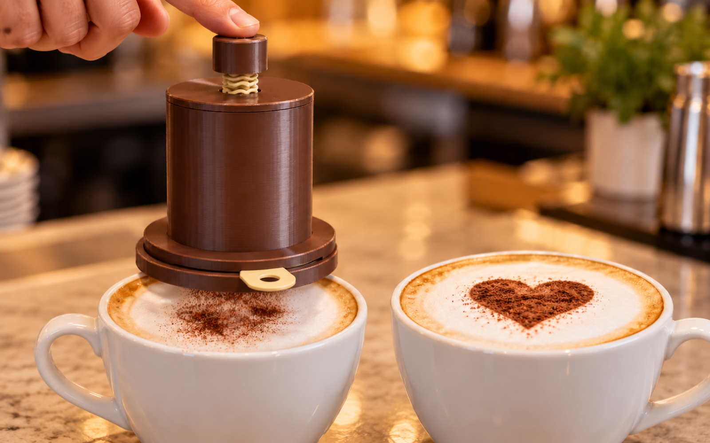
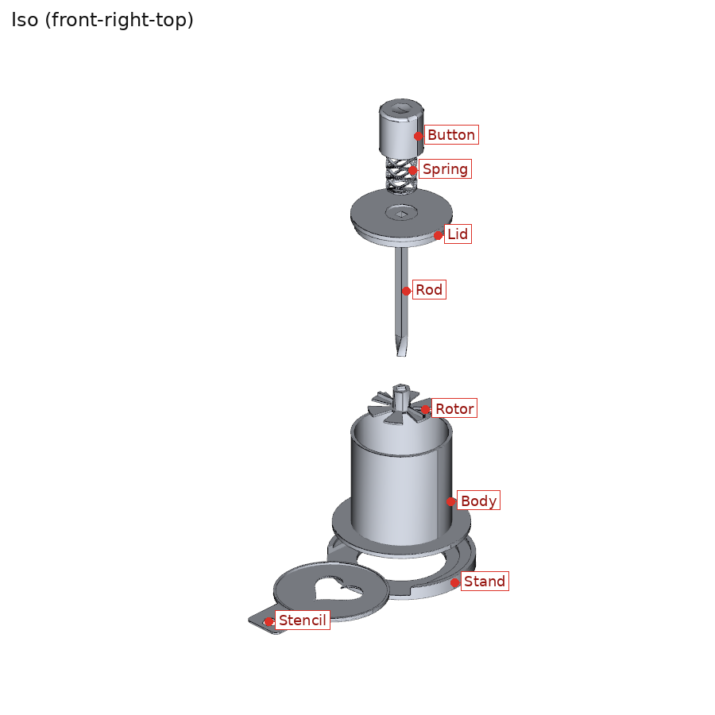
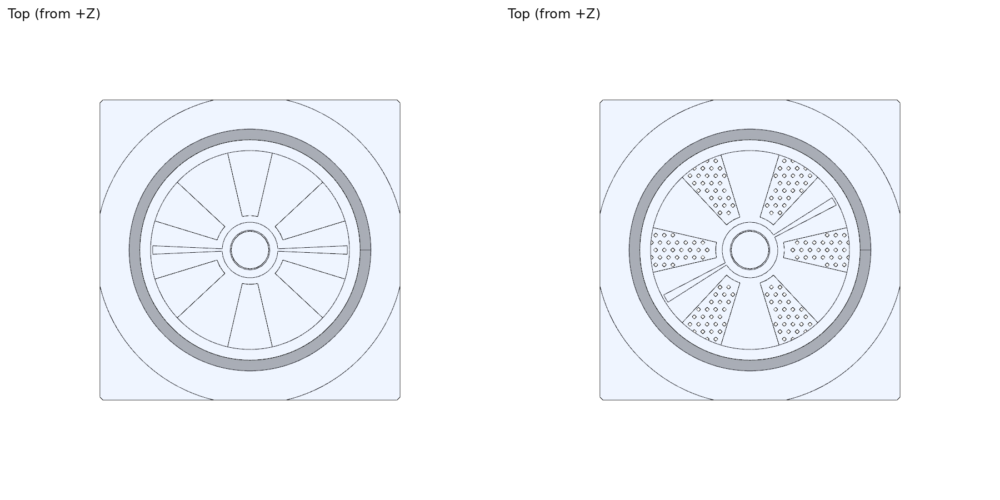
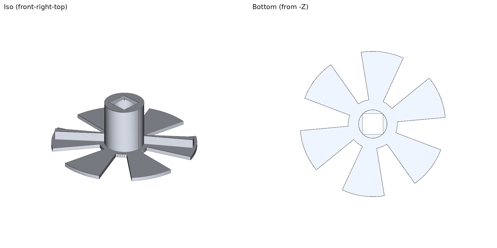
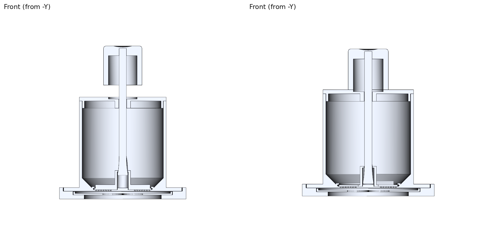
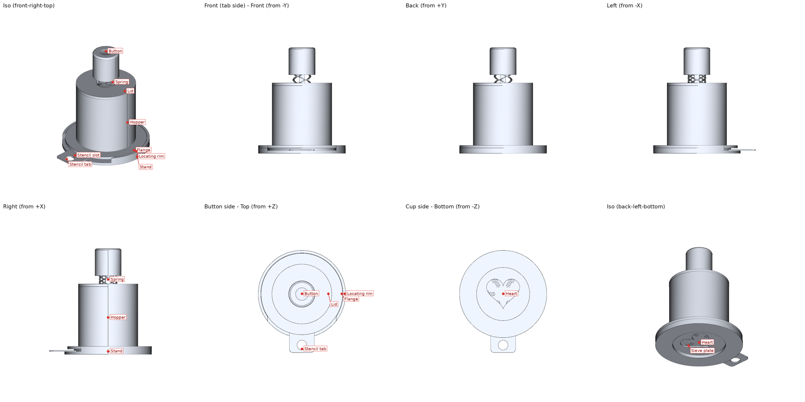

# Cocoa dispenser with stencil and shutter

Push-button cocoa duster for latte art, all parts printed. Put it on the cup, slide a
stencil in, press the button. The press turns a sieve plate open for one dose and the
printed spring turns it closed again. Nothing falls out at rest.

The photos in `renders/` are AI images made with Codex from the version 1 CAD views
(`renders/prompt.txt`); the CAD views are the truth.

## How the shutter works

- The body floor is the **sieve plate**: 1.0 mm holes in six 30-degree sectors, solid
  between them.
- The **rotor** lies on the sieve plate and turns on the **pivot post** (a printed plain
  bearing). Its six solid sectors cover the holes at rest. A **keeper** ridge on the cone
  holds it down; the rotor snaps under it.
- The **rod** is square. Its lower 16 mm are twisted 48 degrees. The rotor boss has a thin
  square **follower**. Pushing the rod 10 mm through the follower turns the rotor 30
  degrees: the open sectors line up with the holes. The upper rod is straight and runs in
  the lid's square hole, so the rod cannot turn itself. This is a push drill.
- Two **vanes** on the rotor stir the cocoa over the holes while it turns.
- Dose: one press = one 30-degree sweep open and back. Press 2 to 4 times. Fewer holes
  (`SIEVE_PITCH`) or a narrower open sector (`OPEN_SHRINK`) give a smaller dose.

## Parts

| Part | Print orientation | Notes |
|---|---|---|
| Stand | flat, as used | sits on the cup rim; stencil slot open on top |
| Stencil | flat | heart cut-out, 1.2 mm, with a 1.5 mm lip: a tray for the spill |
| Body | flange down | sieve plate prints as the first 6 layers; keeper ridge and pivot post inside |
| Rotor | plate down | six open sectors, boss with the square follower on top |
| Rod | standing, square end down | twisted part at the bottom. Use a brim. |
| Lid | upside down | push-fit plug, square guide hole, spring seat |
| Button | upside down | square socket, skirt hides the spring and stops on the lid |
| Spring | flat | PETG wave spring, 8 rings; 38 mm free, 36 at rest, 26 pressed |

No bought parts. Print the spring, the rotor and the rod in PETG: PLA creeps and the
rotor wears. Set `PRINT_SPRING = False` for a bought metal spring (OD 9-10 mm,
free length about 25 mm).

## Assembly

1. Rotor into the body: boss up, press its edge under the keeper ridge, turn it to feel
   it run on the post.
2. Rod through the lid's square hole from below, twisted end down, straight part in the lid.
3. Spring over the rod into the lid seat; press the button onto the rod top (glue drop).
4. Fill the body with cocoa. Push the lid in: the rod's twisted end enters the rotor boss.
   If it does not enter, turn the rotor a little by hand through the cocoa.
5. Stand on the cup, stencil into the slot, body onto the stand. Press.

## Files

- `cocoa_dispenser.py` the model; `uv run cocoa_dispenser.py` writes everything below.
  `cocoa_dispenser_v1.py.bak` is version 1 (up-and-down agitator, no shutter).
- `cocoa_dispenser.step` assembly at rest, `cocoa_dispenser_pressed.step` at full press.
- `stand.stl` ... `spring.stl`: eight parts in print orientation.
- `cocoa_dispenser_plate.stl` and `cocoa_dispenser.3mf`: all eight on one 256 mm plate.
- `uv run cocoa_dispenser.py --serve` opens the configurator on port 8768.

Rebuilt, not printed. Test first: the rotor snaps under the keeper and turns freely;
the rod slides through the follower (0.35 mm clearance) without binding; the shutter is
closed at rest (shake it over paper); the lid push fit (0.2 mm per side).
