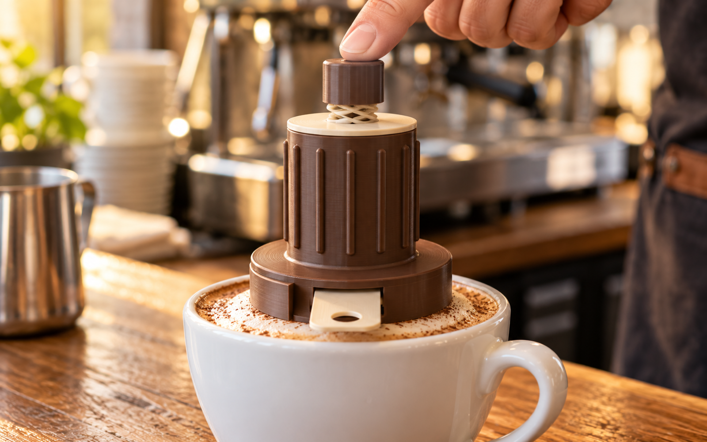
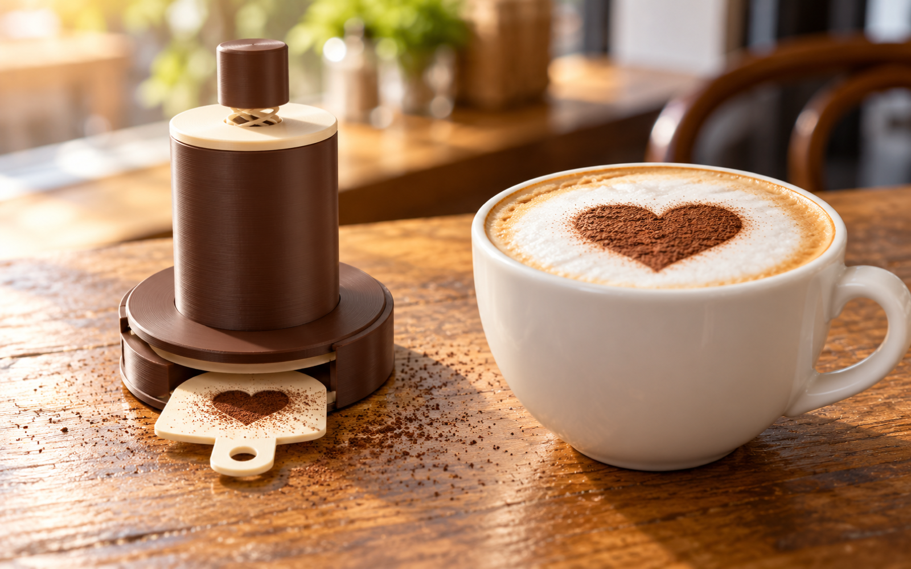
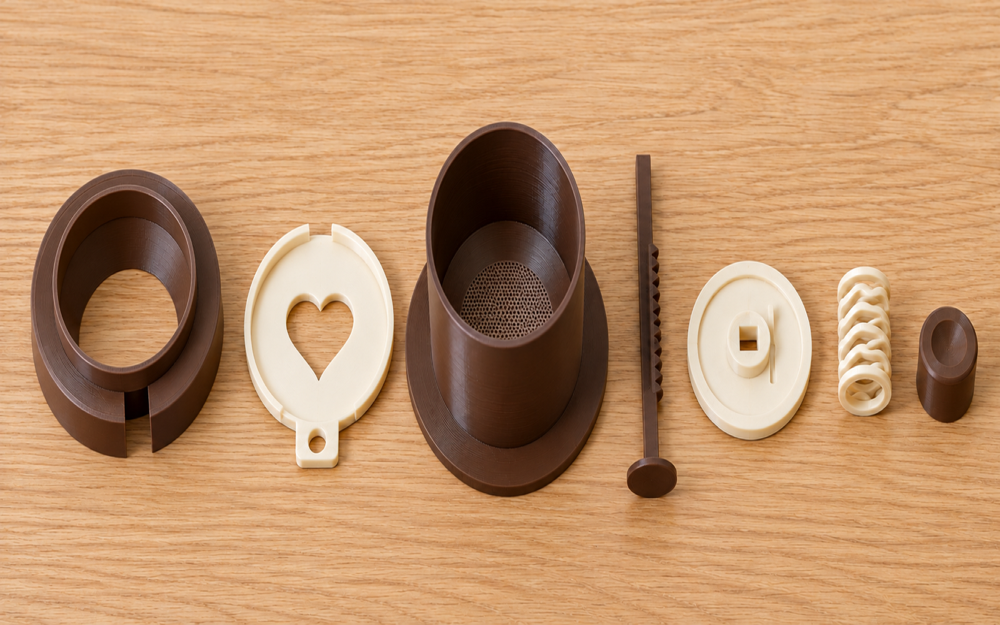
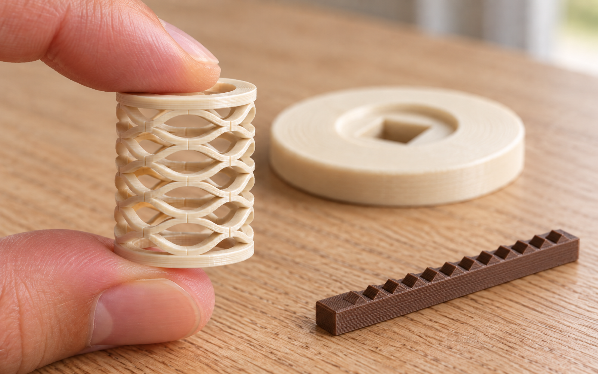
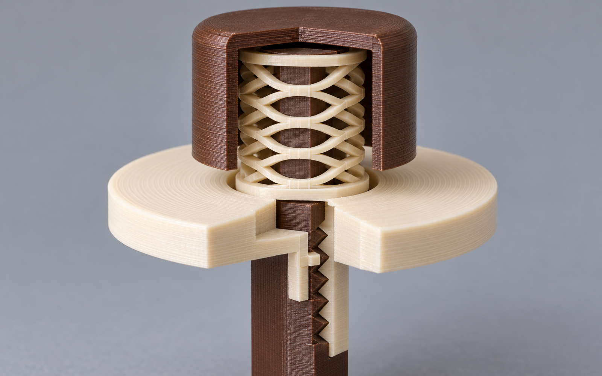

# Cocoa dispenser with stencil and ratchet tapper

Push-button cocoa duster for latte art, all parts printed. Put it on the cup, slide a
stencil in, press the button. The press clicks a toothed rack past a striker tongue
in the lid: every click is one tap on the body, and the taps shake a fine, even dust
of cocoa through the sieve floor. No shutter: the fine holes hold the cocoa at rest,
it bridges over them, the way the LatteShot works.

The photos in `renders/v3/` are AI images made with Codex from the CAD views
(`renders/v3/prompt.txt`, `prompt_photos.txt`, `prompt_spring.txt`); `renders/v2/` and `renders/` hold the earlier versions.
The CAD views are the truth.

## How the tapper works

- The body floor is the **sieve**: 0.8 mm holes on a 1.7 mm hex grid over the whole
  floor, about 1,000 of them, with a 45° cone up to the hopper bore. Cocoa bridges
  over 0.8 mm holes and stays put until something shakes it.
- The **rod** is square and straight. One face carries a **rack**: 11 triangular teeth,
  1.5 mm pitch, 0.8 mm deep, placed so the tongue is on the rack over the whole stroke.
  A 20 mm **foot** at the rod's bottom stirs the cocoa 2 mm above the sieve at full press.
- The **lid** has a square guide hole, so the rack face always faces the tongue, and
  the **striker tongue**: a 0.9 mm thick, 4 mm wide, 8 mm long finger hanging in a
  pocket of the hub, with a 45° nub at its tip that reaches 0.5 mm into the teeth.
  Each tooth bends the tongue 0.5 mm out and lets it snap back: one tap into the lid,
  which is push-fit into the body, which carries the sieve.
- One press of 10 mm = about 4 taps down and 4 up. Press once for a light dust,
  two or three times for a full heart.
- **Dose**: `SIEVE_HOLE` sets the grain (0.8 cocoa, 0.6 to 0.7 cinnamon, which wants
  a 0.2 mm nozzle or a test print), the number of presses sets the amount, and the
  cocoa in the hopper sets the pressure on the sieve: more cocoa, bigger dose. Fill
  it 20 to 30 mm deep for a steady dose.
- `SIEVE_SEPARATE = True` makes the sieve a drop-in disc with a lifting peg on a ring
  ledge, so discs with different holes can be swapped. Off by default: 7 parts.

## Parts

| Part | Print orientation | Notes |
|---|---|---|
| Stand | flat, as used | sits on the cup rim; stencil slot open to the front; 15 mm drop chamber above it, its roof a 45° cone |
| Stencil | flat | heart cut-out, 1.2 mm, with a 3 mm lip: a tray for the spill, pour spout at the back |
| Body | flange down | the sieve floor prints as the first 6 layers; twelve rounded grip ribs around the hopper, rounded flange edge |
| Rod | lying on its -Y face | the foot is flat on that side; the rack teeth print as vertical walls, 13 mm high instead of 102 |
| Lid | upside down | push-fit plug, square guide hole, spring seat, the tongue stands vertical in its pocket |
| Button | upside down | square socket, skirt hides the spring and stops on the lid |
| Spring | flat | PETG wave spring, 8 rings of a 3-layer band; 36.5 mm free, 32.5 at rest, 22.5 pressed; about 0.4 N/mm |

No bought parts. Print the spring, the rod and the lid in PETG: the tongue and the
spring flex, PLA creeps. Food-safe PETG or PLA for the rest. Set
`PRINT_SPRING = False` for a bought metal spring (OD 9 to 10 mm, free length about
25 mm).

## Assembly

1. Rod through the lid's square hole from below, foot down, with the rack face
   toward the tongue (the side of the hub with the slot). It should click as it goes.
2. Spring over the rod into the lid seat; press the button onto the rod top (glue drop).
3. Fill the body with cocoa, 20 to 30 mm. Push the lid in.
4. Stand on the cup, stencil into the slot, body onto the stand. Press.

## Test first

Rebuilt, not printed. Print the lid and the rod alone and click the rack past the
tongue by hand. If the taps are weak, raise `TONGUE_BITE` to 0.7 or make the tongue
three lines thick, and watch the return rule: the spring has to push the tongue back up
the last tooth on its own, so a stronger tongue wants more `PRELOAD` or a longer
`RACK_PITCH` (the build prints both forces). If the tongue breaks, lengthen `TONGUE_L`. Then shake the filled
body over paper: nothing should fall at rest with 0.8 mm holes.

## Rebuilding fast

The model is smlibpy. Parts are cached on disk in `.cache/` as native `.smb` files,
keyed by the settings each part uses and the builder's own source, and so are their
STLs. A change to a grip or flange setting rebuilds the body's shell and unions the
cached sieve floor into it; the thousand holes are cut once, in 2D before the
extrusion. The interference and orientation checks use the body with a plain floor,
because meshing the holes for every check took minutes. A warm run takes about 35 s.
`--no-cache` builds everything from scratch; delete `.cache/` to start over.

## Files

- `cocoa_dispenser.py` the model; `uv run cocoa_dispenser.py` writes everything below.
  `cocoa_dispenser_v1.py.bak` is version 1 (agitator, no shutter),
  `cocoa_dispenser_v2.py.bak` version 2 (rotating shutter), `cocoa_dispenser_v2chamber.py.bak`
  version 2 with the drop chamber and aperture disc.
- `cocoa_dispenser.step` assembly at rest, `cocoa_dispenser_pressed.step` at full press.
- `stand.stl` ... `spring.stl`: seven parts in print orientation.
- `cocoa_dispenser_plate.stl` and `cocoa_dispenser.3mf`: all seven on one 256 mm plate.
- `sections.py` draws `views/section_rest_pressed.png` and `views/tongue_closeup.png`.
- `uv run check_part.py cocoa_dispenser.py --max-overhang-area 400 --skip spring` checks
  each part and the assembly; the heart's cusp counts as a knife edge, which is the shape.
  The spring is skipped by design: its band is three layers, the rings meet tangentially,
  and each wave underside is a bridge of about 10 mm, which prints fine but reads as overhang.
  The lid's thin-wall finding is the tongue, two lines by design. The stand reports
  about 8 mm² where the 45° slot roof meets the channel: the geometry is the same as
  the CadQuery version, and that mesh's samples happened to miss the edge.
- Rounds: `STAND_R`, `FLANGE_R` and `LID_R` round the window and rim edges of the stand,
  the joint between hopper and flange, and the top of the guide hub. The CadQuery
  version picked those edges, and the port keeps them.
- The wave rings are smooth closed lofts, and the flat end rings are 0.1 mm wider per
  side than the band (`WS_END_LAP`): with faces on the same cylinders, smlibpy could
  not fuse them. The spring is 0.8 cm³, 0.03 more than before.
- `cocoa_dispenser.3mf` is the project saved from Bambu Studio, split into its parts.
  Rebuild it from `cocoa_dispenser_plate.stl` with `make_3mf.py` when the parts change.
- `uv run cocoa_dispenser.py --serve` opens the configurator on port 8768.
