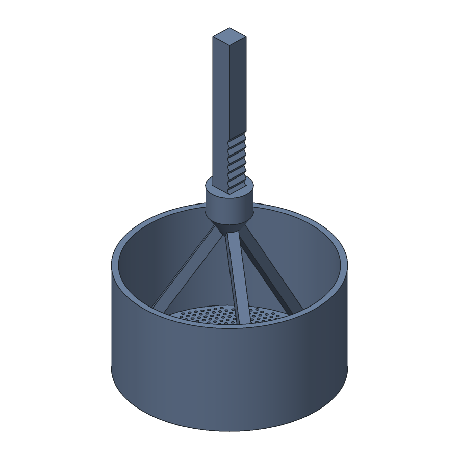
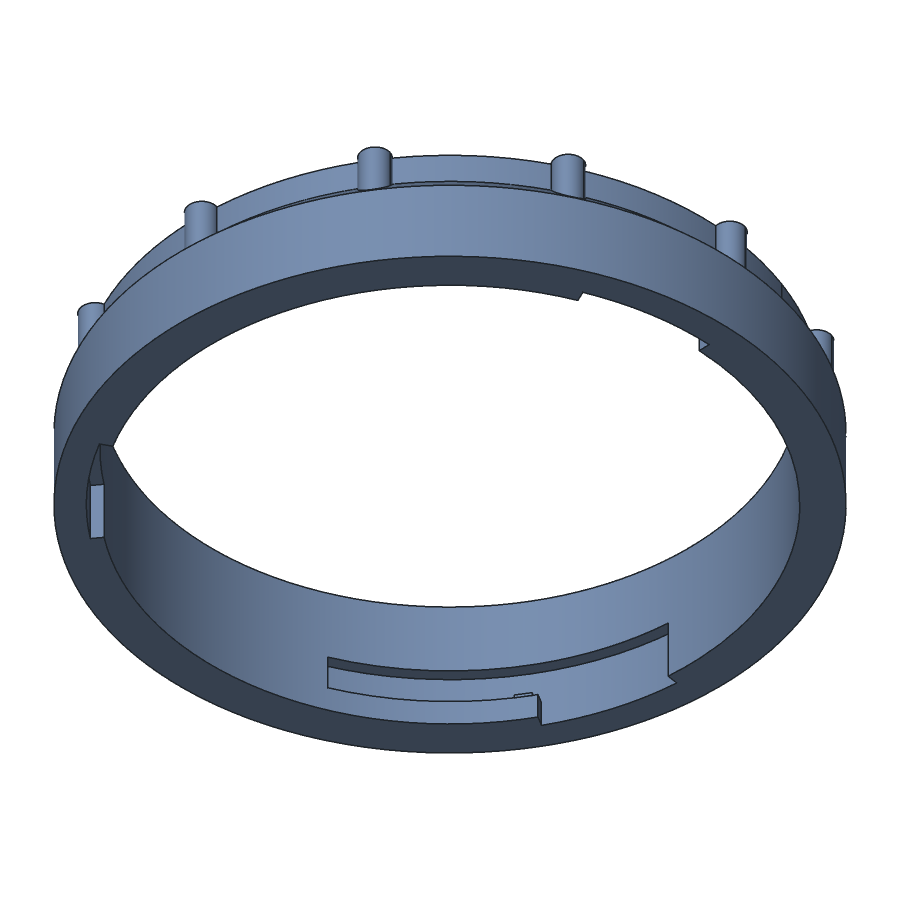
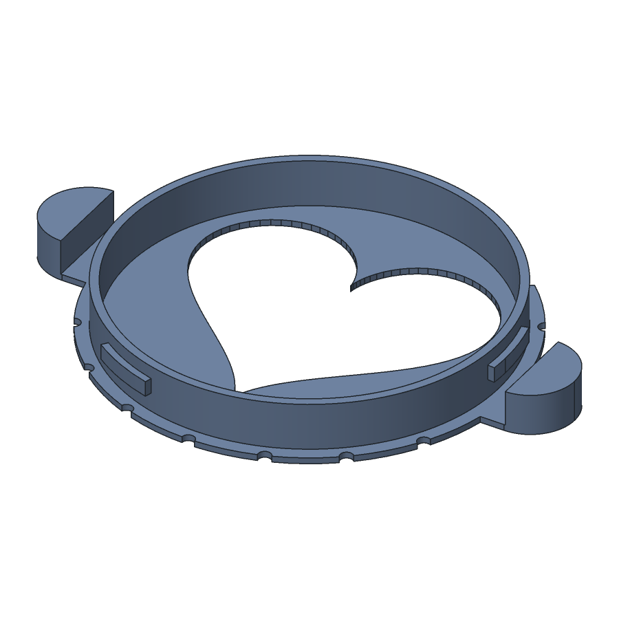
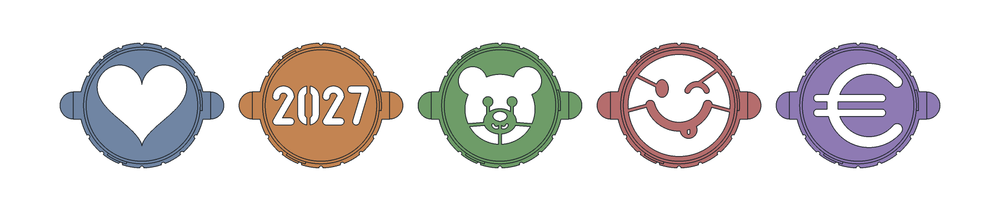
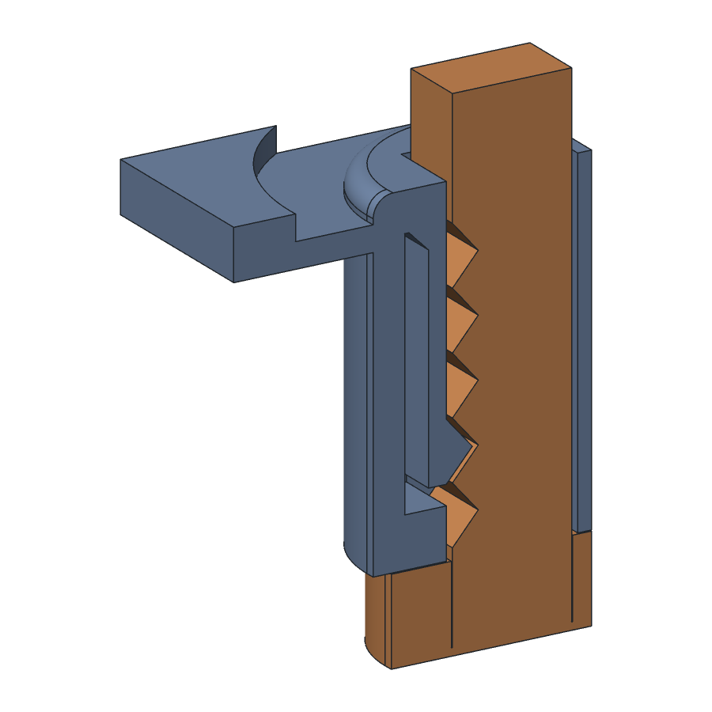

# Cocoa dispenser with stencil and ratchet tapper

Push-button cocoa duster for latte art, all parts printed. Hold it over the coffee and
press the button. The button pushes the cocoa cup down and the spring lifts it again.
The cup's floor is the sieve. On the way a toothed rack clicks past a striker tongue in
the lid: every click shakes the cup, and the cocoa falls as a fine, even dust through the
heart in the stencil. No shutter: the fine holes hold the cocoa at rest, it bridges over
them, the way the LatteShot works.

Version 4 has six parts. One slim tube replaces the stand and the hopper, the stencil locks into its bottom with a bayonet, and the rod is part of the
cocoa cup.

The photos in `renders/` show version 3 and earlier. They are AI images made with Codex
from the CAD views. The CAD views are the truth.

## How it works

- The **cocoa cup** moves, sieve and all. Its floor has 0.8 mm holes on a 1.7 mm hex
  grid, 871 of them, and a 30 mm wall holds the cocoa. Cocoa bridges over 0.8 mm holes
  and stays put until something shakes it.
- Three **ribs in a triangle** carry the cup from its rim up to a round block, 45 mm
  above the floor and clear of the cocoa. The rod grows out of that block. Nothing
  touches the middle of the sieve. Version 3 had a round agitator foot on the rod there,
  which held the cocoa above it and packed it onto the middle holes.
- The **body** is one thin tube, 4 lines thick and 69 mm wide. Its bore guides the cup
  with 0.3 mm play per side. It has no foot: you hold it just over the coffee. The
  twelve grip ribs run between two bayonet bands, one at each end, so none of them
  starts in the air.
- The **stencil** goes in from below and locks with a **bayonet**: push it up, turn it
  35°, and it clicks over a 0.3 mm bump. Three lugs on its collar ride in L grooves in
  a thicker ring at the body bottom. The bayonet also sets the way the shape points.
  Two ears on the flange end in solid 5 mm tabs, outside the band, for the fingers. Between the stencil and the sieve is a 20 mm drop
  chamber.
- The **rod** is square. One face carries a **rack**: 5 triangular teeth, 3 mm pitch,
  1.3 mm deep, placed so the tongue is on the rack over the whole stroke.
- The **lid** locks into the top band with the same **bayonet** as the stencil: three
  lugs on its plug, a 35° turn and a click. The spring pushes the lugs up against the
  groove ceilings, so the lid sits tight, 0.5 mm over the tube rim. Its plate is as wide
  as the band, with 18 notches for the fingers.
- The lid also has a square guide hole, so the rack face always faces the tongue, the
  **striker tongue** in a pocket of the hub, and a 140° **pour opening** between the
  button and the plug. The tongue is 12 mm long with a gusset at its root,
  and its nub has the slope of the teeth. Each tooth bends it 1 mm out and lets it snap
  back, and the click goes down the rod into the cup. The nub still reaches 0.7 mm into
  the teeth when the rod leans away by its full play.
- One press of 10 mm is about 3 taps down and 3 up. The button lands on the lid at the
  bottom; at rest the carrier block stops 0.05 mm under the lid hub. Press once for a
  light dust, two or three times for a full heart.
- **Dose**: `SIEVE_HOLE` sets the grain (0.8 cocoa, 0.6 to 0.7 cinnamon, which wants a
  0.2 mm nozzle or a test print), the number of presses sets the amount, and the depth
  of cocoa sets the pressure on the sieve. Fill the cup 20 to 25 mm for a steady dose,
  below its rim, so no cocoa reaches the gap around the cup.
- The spring lifts the cup and the cocoa: about 2 N at rest and 10 N at the bottom of
  a press. `TS_COIL` and `TS_SLOT` set it.
- The **spring** is a slotted tube: 26 mm across with a 17 mm hole, round the 14 mm lid
  hub. Three helical slots, 1.7 mm high, wind three turns each through its 4.5 mm wall
  and leave 2 mm coils between them, with round ends and a solid 2 mm ring at each end.
  The coils twist like the wire of a coil spring. Every vertical line through the wall
  crosses nine slots, so the spring has 15 mm of travel and stays 2.8 mm short of
  solid at full press.
- The **button** is 32 mm wide and 32 mm tall. Its skirt hides the spring, so the spring
  sets its size.

## Stencils

`STENCIL` picks the shape: 0 a heart, 1 the year 2027, 2 a bear, 3 a smiling face that
winks with its tongue out, 4 the euro sign. `SHAPE_W` is the heart's width, and every
other shape is scaled to reach as far from the centre as that heart, 26 mm at 46.
A shape with islands holds them with 1.6 mm bridges (`BRIDGE`), so each stencil
prints as one part: the 0 has one at its top and bottom, the bear's eyes hang on its
muzzle and the muzzle on its chin and two whiskers, and the face's eyes and grin hang
on rays out to its edge. The bridges leave thin pale lines in the cocoa, which the cloud
may partly fill (not tried yet). The build stops if a shape's finest line gets thinner
than two lines, so `SHAPE_W` goes from 36 to 48.

## Parts

| Part | Print orientation | Notes |
|---|---|---|
| Body | bayonet band down, as used | tube, a bayonet band at each end with three L grooves and 45° faces to the tube, twelve grip ribs between the bands; 69 mm wide, 106 mm tall |
| Stencil | flange down | heart or another shape cut out of a notched flange with two grip ears; the collar, lugs and ear tabs stand up; the lug undersides are 1 mm overhangs |
| Cup | floor down, as used | sieve, wall, three ribs and the rack rod in one part, 112 mm tall. The holes print vertical, the ribs stand 30° from vertical, a steep cone holds the block, and the down flanks of the teeth are 41° from vertical: no supports |
| Lid | upside down | plug with three bayonet lugs (1 mm overhangs), notched plate, square guide hole, spring seat, pour opening; the tongue stands vertical in its pocket |
| Button | upside down | square socket, skirt hides the spring and stops on the lid |
| Spring | standing, as used | PETG slotted tube, 26 mm across, 17 mm hole; 39.0 mm free, 36.5 at rest, 26.5 pressed, solid at 23.7; about 0.8 N/mm |

Version 4 first had a wave spring of thin rings that met at their crests. It could not be
printed. The slotted tube prints as a plain tube: each layer, the ceiling of a slot moves
1.2 mm on round the tube, and three slots side by side keep that short. A slotted spring
from a generator works the same way, but a short one with 0.5 mm slots closes after about
3 mm: this one needs 12.5 mm, from free length to full press.

No bought parts. Print the spring, the cup and the lid in PETG: the tongue and the
spring flex, PLA creeps. Print the spring standing, with no supports in the slots. Food-safe PETG or PLA for the rest. Set
`PRINT_SPRING = False` for a bought metal spring that goes over the 14 mm hub (OD 19 mm,
wire 0.8 to 1 mm, free length about 32 mm). The model uses 0.16 mm layers.

## Assembly

1. The cup's rod through the lid's square hole from below, with the rack face toward the
   tongue (the side of the hub with the slot). It should click as it goes.
2. Spring over the rod into the lid seat; press the button onto the rod top (glue drop).
3. Stencil into the body bottom: lugs into the slots, push up, turn until it clicks.
4. Lower the cup into the body, lugs of the lid into the top slots, push down and turn
   until it clicks.
5. Pour cocoa through the opening in the lid, 20 to 25 mm deep.
6. Hold the body just over the coffee and press.
7. To change the stencil, twist it back and pull it down. To clean the cup, twist the lid back and
   lift it: the cup comes out with it.

## Test first

Rebuilt, not printed. Print the lid and the cup first and click the rack past the
tongue by hand. Print the stencil and the bottom 15 mm of the body to try the bayonet. If the taps are weak, raise `TONGUE_BITE` to 1.2 or make the tongue
three lines thick, and watch the return rule: the spring has to push the tongue back up
the last tooth on its own, so a stronger tongue wants more `PRELOAD` or a longer
`RACK_PITCH` (the build prints both forces). If the tongue breaks, lengthen `TONGUE_L`. Then shake the filled
cup over paper: nothing should fall at rest with 0.8 mm holes.

## Rebuilding fast

The model is smlibpy. Parts are cached on disk in `.cache/` as native `.smb` files,
keyed by the settings each part uses and the builder's own source, and so are their
STLs. The cup's holes are cut once, in 2D before the extrusion. The interference
checks, the configurator drawing and the configurator section use a cup with no holes,
because meshing the holes for every check took minutes. A warm run takes about 30 s.
`--no-cache` builds everything from scratch; delete `.cache/` to start over.

## Files

- `cocoa_dispenser.py` the model; `uv run cocoa_dispenser.py` writes everything below.
  The `.py.bak` files are versions 1 and 2.
- `cocoa_dispenser.step` assembly at rest, `cocoa_dispenser_pressed.step` at full press.
- `body.stl`, `stencil.stl`, `cup.stl`, `lid.stl`, `button.stl`, `spring.stl`: six parts
  in print orientation, and `cocoa_dispenser_plate.stl` with all six on one plate.
- `stencils/` has a stencil for each shape: `stencil_heart.stl`, `stencil_2027.stl`,
  `stencil_bear.stl`, `stencil_smile.stl` and `stencil_euro.stl`. `STENCIL` picks the one
  on the plate and in the views.
- `sections.py` draws `views/section_rest_pressed.png` and `views/tongue_closeup.png`.
- `uv run check_part.py cocoa_dispenser.py --max-overhang-area 600 --skip spring` checks
  each part and the assembly. Most of the lid's 506 mm2 of overhang is the floor of the
  spring seat, which the upside-down lid prints as a 7 mm bridge from the hub to the rim. Two findings stay by design: the heart's cusp counts as a
  knife edge, and the lid's thin wall is the tongue, two lines thick. The spring is
  skipped: the ceilings of its slots are overhangs by design, 2,800 mm2 of them, each
  layer printing 1.2 mm past the one under it.
- `LID_R` rounds the top of the guide hub.
- The spring's slots are rectangles swept along helices. A compressed spring in the
  pressed views has lower slots, and the build prints its rate, the twist in its coils
  and how far a slot ceiling moves per layer.
- `cocoa_dispenser.3mf` is the project saved from Bambu Studio. It still holds version 3.
  Make a new project from `cocoa_dispenser_plate.stl` before printing version 4.
- `uv run cocoa_dispenser.py --serve` opens the configurator on port 8768. It shows
  the 25 settings a user should change: the stencil shape, sizes, fits, the taps, the
  tongue and the spring.
  The other values are fixed in the script. Its Section
  view cuts the assembly from the front, the side or the top, with a slider for the
  place of the cut and each part named on its cut face.
