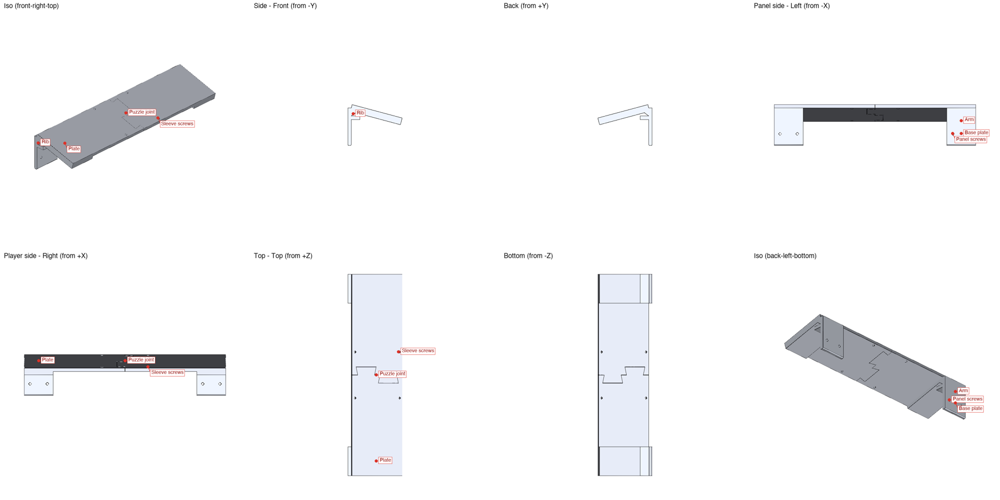

# Mixer riser for a Yamaha Tyros 3

Two printed pieces that hold the [mixer sleeve](../mixer-sleeve) above a Tyros 3,
tilted 15° toward the player, with no screws between the printed parts. The Tyros
rear panel has four threaded holes in a row near its top edge, an outer pair
330 mm apart and an inner pair 270 mm apart, so each side has two holes 30 mm
apart. Each side piece screws into its pair with M5 screws, hooks over the
keyboard's rear edge with a ledge, and carries its half of the tilted plate in
the same print. The two halves meet in the middle with a dovetail puzzle joint
that drops together; the sleeve bolted on top with its own four M4 screws then
holds both halves down. The plate's underside sits a thumb, 20 mm, above the
rear edge. The span is wider than a 256 mm bed, which is why it is two pieces.

<p align="center">
  
</p>

## Files

| File | What it is |
|---|---|
| `mixer_riser.py` | The parametric CadQuery model: `build()` is the assembly, `parts()` the two printable pieces |
| `mixer_riser.step` | The assembly in the use orientation: panel plane at x = 0, player side +x, up +z |
| `mixer_riser_left.stl`, `.3mf` | The left piece, standing on its bracket, every wall vertical |
| `mixer_riser_right.stl`, `.3mf` | The right piece: the mirror, with tongue and socket swapped |
| `print_settings.json` | The recommended slicer settings that go into the 3MFs |
| `bambu_p1s_0.4.config` | Printer and filament template: Bambu Lab P1S, 0.4 mm nozzle |
| `labels.json` | Named anchor points that `render_views.py` draws as tags on the assembly |
| `check_part.py` | The checker; it checks each piece and the assembly. Run with `--max-overhang-area 300`, the ceilings of the horizontal screw holes count as overhang and print fine |
| `device()`, `features()` in `mixer_riser.py` | The keyboard's panel and sloped top plus the sleeve as ghosts, and the named features with the settings behind each |

## Rebuild

```bash
uv run mixer_riser.py
uv run render_views.py mixer_riser.step --labels labels.json --out views
uv run make_3mf.py mixer_riser_left.stl --settings print_settings.json \
  --template bambu_p1s_0.4.config --out mixer_riser_left.3mf
uv run make_3mf.py mixer_riser_right.stl --settings print_settings.json \
  --template bambu_p1s_0.4.config --out mixer_riser_right.3mf
```

To adjust it with sliders, with the keyboard and the sleeve drawn as ghosts, from
a phone on the same network too:

```bash
uv run mixer_riser.py --serve --lan --port 8767
```

## Assembly

1. Screw each piece to its pair of holes, M5, ledge resting on the keyboard's top.
2. Push the two plate halves together in the middle: each has a dovetail tongue
   and a socket, so they only go one way.
3. Set the sleeve on the plate and drive its four M4 screws into the sleeve's
   mount pads, two through each half.

## Named features

| Name | Where it is |
|---|---|
| Base plate | The vertical plate against the rear panel, with its pair of screw holes |
| Panel screws | Two M5 clearance holes 30 mm apart, heads on the rear face |
| Arm | The base plate continuing up past the panel's top edge |
| Ledge | A tab from the arm that rests on the keyboard's top, over the rear edge, taking the weight |
| Rib | Two ribs flush with the bracket's side faces, bracing the plate down to the ledge |
| Plate | The piece's half of the 90 mm deep plate, from the bracket to the middle, 6 mm thick |
| Puzzle joint | A 14 mm dovetail tongue and a matching socket at the middle, 0.2 mm clearance |
| Sleeve screws | The sleeve's 80 × 80 pattern, M4, two holes per piece |

## Main settings

| Setting | Value | Meaning |
|---|---|---|
| `OUTER`, `INNER` | 330, 270 mm | The outer and inner pairs of panel holes, measured 33 and 27 cm |
| `SCREW_D`, `HEAD_D` | M5, 9 mm | Panel screws; the two heads of a pair must not touch |
| `PANEL_TOP` | 25 mm | Height of the panel's top edge above the holes, measured |
| `EDGE_GAP` | 20 mm | Gap between the rear edge and the plate's underside: a thumb |
| `LEDGE` | 15 mm | How far the ledge reaches over the keyboard's top |
| `TILT`, `PLATE_L` | 15°, 90 mm | Slope toward the player and the plate's depth along it |
| `T`, `BRK_W` | 6 mm, 50 mm | Profile thickness and bracket width; two M5 heads 30 mm apart need 49 |
| `JOINT`, `JOINT_W`, `JOINT_FLARE`, `JOINT_FIT` | 14, 30, 3, 0.2 mm | The dovetail: length, root width, flare per side, clearance per side |
| `PATTERN`, `SLEEVE_SCREW_D` | 80 mm, M4 | The sleeve's mount pattern and its screws |
| `TOP_TILT` | 8° | The keyboard top's own slope, for the ghost only |

Each piece prints standing on its bracket, 189 mm tall, with 4 walls and 30 %
infill; no supports. It carries a 1.3 kg mixer for years, so print it in PETG
or ASA. If the dovetail is tight, raise `JOINT_FIT`; if it rattles, lower it.
Not printed yet.
