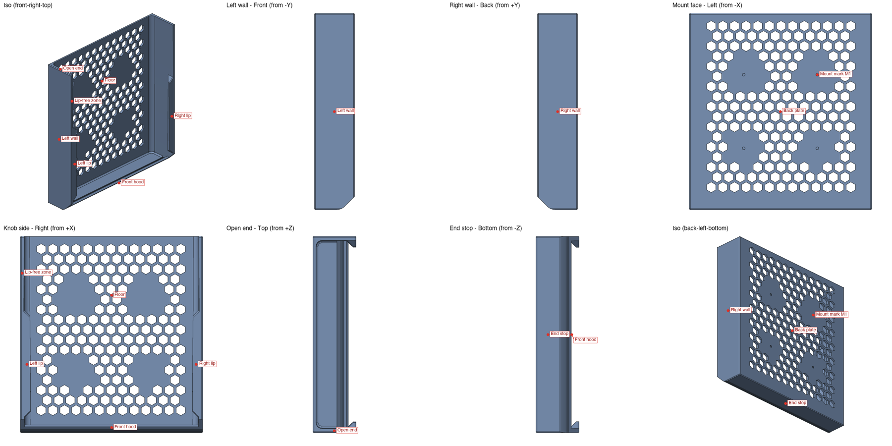
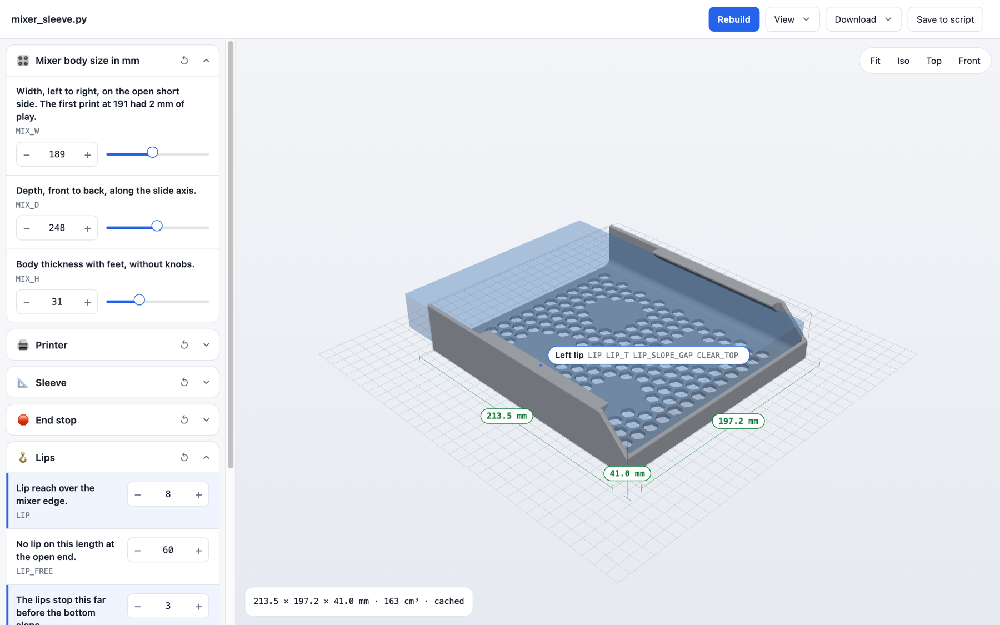

# Mixer sleeve for the Behringer Xenyx 1002SFX

A wall sleeve that holds a Behringer Xenyx 1002SFX mixer upright. The sleeve
screws to an existing mount on the wall, and the mixer slides in from the open
top, front edge first, until it rests on the end stop. The knobs stay
reachable through the open front, and the rear jacks stay free at the top.

<p align="center">
  
</p>

**Reworked on 2026-11-26, not printed yet.** The print of 2026-10-23 (commit d45bee2) fitted in width, but a
side lip broke: the model took the mixer as 26 mm thick, which left 2.4 mm under a 2 mm lip. The mixer measures
29.5 mm over a foot and 35.7 mm over the jack block at the rear. The sleeve now has 43.5 mm walls, 2.8 mm lips on a
full 45° fill, and a rounded hood over the front edge in place of the low end stop.

## Files

| File | What it is |
|---|---|
| `mixer_sleeve.py` | The parametric smlibpy model. Every size is a named setting at the top |
| `mixer_sleeve.stl` | Print-ready mesh, already lying flat on its back |
| `mixer_sleeve.step` | Editable CAD file, standing upright as mounted |
| `mixer_sleeve.3mf` | Bambu Studio project with the recommended print settings, ready to slice |
| `print_settings.json` | The recommended slicer settings that go into the 3MF |
| `bambu_p1s_0.4.config` | Printer and filament template: Bambu Lab P1S, 0.4 mm nozzle, Bambu PLA Basic |
| `make_3mf.py` | Builds the 3MF from the STL, the settings and the template |
| `labels.json` | Named anchor points that `render_views.py` draws as tags |
| `render_views.py` | Renders the labeled views in `views/` |
| `check_part.py` | The checker: thin walls, knife edges, overhangs in the print orientation and a clash with the mixer. The sleeve passes all of them |
| `device()`, `features()` in `mixer_sleeve.py` | The mixer body as a ghost for the configurator, and the named features with the settings behind each, used for the view tags and for click-to-highlight |
| `sections.png` | Cross-sections through the lip and the end stop |

## Rebuild

```bash
uv run mixer_sleeve.py
uv run render_views.py mixer_sleeve.step --labels labels.json --out views
uv run make_3mf.py mixer_sleeve.stl --settings print_settings.json \
  --template bambu_p1s_0.4.config --out mixer_sleeve.3mf
```

For another printer, save any project in Bambu Studio or OrcaSlicer with your
printer and filament, and pass that `.3mf` as `--template`.

To adjust the sleeve with sliders instead, serve the configurator from the
script itself. It opens at <http://127.0.0.1:8765/>:

```bash
uv run mixer_sleeve.py --serve --open
```

<p align="center">
  
</p>

## Named sides and features

Use these names when you ask for a change.

| Name | Where it is |
|---|---|
| Back plate / Mount face | The flat back that screws to the wall mount |
| Mount marks M1–M4 | Small marks for the mount screws, 80 × 80 mm apart, each in a solid pad |
| Left wall, Right wall | The long sides that grip the mixer. Their inner faces bow to follow the body, from a spline through the three measured widths |
| Left lip, Right lip | 6.8 mm lips over the mixer's front edge, 2.8 mm thick, with a fill underneath at 45°. Each end runs down to the wall as a triangle |
| Lip-free zone | The top 80 mm, where the lips stop so the mixer goes in easily and the raised jack block has room |
| Open end | The top, where the mixer slides in |
| End stop | The solid stop at the bottom that carries the mixer, up to where the mixer's front edge starts to curve |
| Front hood | A shell as thick as the stop that curls over the rounded front edge of the mixer, up to 45° and then straight, so it prints without supports |
| Wall ends | The top front corner of each wall is cut along the outside of the hood and then at 45° to the wall top, so wall and hood are one surface |
| Back vents | 11.5 mm hexes in the back. The side walls and the end stop are solid |
| Floor fillet | The 6 mm rounding between the walls and the back plate |
| Gussets | Optional 10 mm ribs at 45° on the outside of each wall, off by default (`GUSSETS`) |

## Main settings

The configurator shows only the measured sizes of the mixer and the feature switches. Everything else is a fixed
value in the script.

| Setting | Value | Meaning |
|---|---|---|
| `MIX_W`, `MIX_W_BOTTOM`, `MIX_W_TOP` | 190, 188, 189 mm | The body is barrel shaped: width at the widest point, at the bottom edge, and at the sleeve's open end |
| `MIX_D` | 215 mm | Depth, front to back |
| `MIX_H` | 29.5 mm | Thickness over a foot, without knobs. Beside a foot the side edge is 26.3 mm |
| `REAR_H`, `REAR_L` | 35.7, 78 mm | Thickness over the raised jack block at the rear, and its length. The length is an estimate from a photo |
| `FRONT_R` | 9 mm | Radius of the rounded top front edge, which the hood follows. An estimate from a photo |
| `FRONT_LIP` | on | The rounded hood. Off brings back the low end stop with corner triangles |
| `WALL_SLOPE` | on | The wall ends cut along the hood |
| `GUSSETS`, `SIDE_VENTS`, `END_VENTS` | off | Ribs on the walls, vents in the walls, vents in the end stop |

Fixed in the script, among others:

| Value | | Meaning |
|---|---|---|
| Wall height | 43.5 mm | Follows the mixer: the body, the gap above it, the lip fill and the lip, and never lower than the jack block |
| Lip-free length | 80 mm | Follows the jack block, and is at least 80 mm |
| `SLEEVE_H` | 213.5 mm | Total height, kept below a microphone arm hinge |
| `CLEAR`, `CLEAR_TOP` | 0.5, 1.12 mm | Gap on each side and at the end stop, and above the body under the lips |
| `WALL`, `END`, `BASE` | 3.6, 2.7, 3.08 mm | Side walls of 8 lines, end stop of 6 lines, back plate of 11 layers |
| `LIP`, `LIP_T`, `LIP_TAPER` | 6.8, 2.8, 8 mm | Lip reach, thickness and the length of its triangular ends |
| `HOLE_PATTERN` | 80 × 80 mm | Mount screw spacing |
| `NOZZLE`, `LINE`, `LAYER` | 0.4, 0.45, 0.28 mm | Printer settings the thicknesses are counted in |

Outside size: 198.2 × 43.5 × 213.5 mm.

## Print settings

`mixer_sleeve.3mf` already has these set on the object:

- Orientation: flat on the back plate, as the STL is exported. No supports are needed.
- 0.4 mm nozzle, 0.28 mm layers (0.2 mm first layer), 4 wall loops
- 15% gyroid sparse infill, 4 top and 3 bottom shell layers, aligned seam, auto brim

The rebuilt project has not been sliced, so its print time and weight are not known. The part is about 181 cm³.
The floor edge at the open end stays sharp: smlibpy cannot round it where it runs into the floor fillets. The template uses PLA. A lip of the first print broke, and the part holds weight for years, so PETG or ASA is the better choice.
