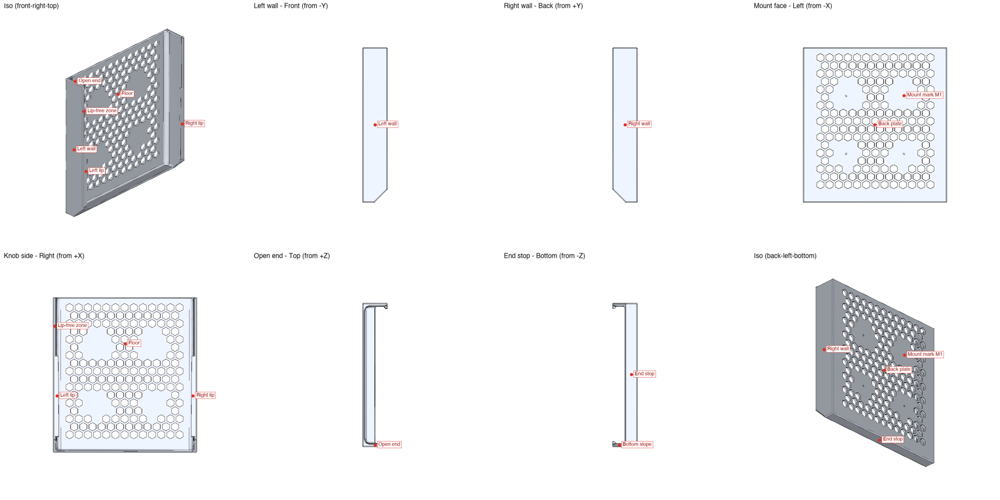

# Mixer sleeve for the Behringer Xenyx 1002SFX

A wall sleeve that holds a Behringer Xenyx 1002SFX mixer upright. The sleeve
screws to an existing mount on the wall, and the mixer slides in from the open
top, front edge first, until it rests on the end stop. The knobs stay
reachable through the open front, and the rear jacks stay free at the top.

<p align="center">
  
</p>

## Files

| File | What it is |
|---|---|
| `mixer_sleeve.py` | The parametric CadQuery model. Every size is a named setting at the top |
| `mixer_sleeve.stl` | Print-ready mesh, already lying flat on its back |
| `mixer_sleeve.step` | Editable CAD file, standing upright as mounted |
| `mixer_sleeve.3mf` | Bambu Studio project with the recommended print settings, ready to slice |
| `print_settings.json` | The recommended slicer settings that go into the 3MF |
| `bambu_p1s_0.4.config` | Printer and filament template: Bambu Lab P1S, 0.4 mm nozzle, Bambu PLA Basic |
| `make_3mf.py` | Builds the 3MF from the STL, the settings and the template |
| `labels.json` | Named anchor points that `render_views.py` draws as tags |
| `render_views.py` | Renders the labeled views in `views/` |
| `device()` in `mixer_sleeve.py` | The mixer body in its resting position, drawn as a ghost by the configurator, never exported |
| `sections.png` | Cross-sections through the lip and the end stop |

## Rebuild

```bash
uv run mixer_sleeve.py
uv run render_views.py mixer_sleeve.step --labels labels.json --out views
uv run make_3mf.py mixer_sleeve.stl --settings print_settings.json \
  --template bambu_p1s_0.4.config --out mixer_sleeve.3mf
```

For another printer, save any project in Bambu Studio or OrcaSlicer with your
printer and filament, and pass that `.3mf` as `--template`.

To adjust the sleeve with sliders instead, run the configurator from the repo
root and open <http://127.0.0.1:8765/>:

```bash
uv run skills/cad-print-design/scripts/serve.py projects/mixer-sleeve/mixer_sleeve.py --port 8765
```

## Named sides and features

Use these names when you ask for a change.

| Name | Where it is |
|---|---|
| Back plate / Mount face | The flat back that screws to the wall mount |
| Mount marks M1–M4 | Small marks for the mount screws, 80 × 80 mm apart, each in a solid pad |
| Left wall, Right wall | The long sides that grip the mixer |
| Left lip, Right lip | 8 mm lips over the mixer's front edge, with a 45° fill underneath |
| Lip-free zone | The top 60 mm, where the lips stop so the mixer goes in easily |
| Open end | The top, where the mixer slides in |
| End stop | The low 16 mm stop at the bottom that carries the mixer |
| Bottom slope | The 45° run from the walls down to the end stop |
| Back vents | 11.5 mm hexes in the back. The side walls are solid since the first print broke there |
| Floor fillet | The 6 mm rounding between the walls and the back plate |
| Gussets | Four 10 mm ribs at 45° on the outside of each wall, 40 mm apart, bracing the wall to the back plate |

## Main settings

| Setting | Value | Meaning |
|---|---|---|
| `MIX_W × MIX_D × MIX_H` | 189 × 248 × 25 mm | Mixer body, measured without knobs. The first print at 191 had 2 mm of side play |
| `CLEAR` | 0.5 mm | Gap on each side and at the end stop |
| `SLEEVE_H` | 213.5 mm | Total height, kept below a microphone arm hinge |
| `WALL_H` | 50 mm | Outer side wall height, so the lips clear the mixer |
| `WALL` | 3.6 mm | 8 lines: 4 wall loops per side, no infill |
| `END` | 2.7 mm | 6 lines: 3 wall loops per side, no infill |
| `FILLET` | 6 mm | Floor fillet between the walls and the back plate |
| `GUSSET`, `GUSSET_T`, `GUSSET_PITCH` | 10 mm, 2.7 mm, 40 mm | Outside gusset reach and height, thickness, spacing |
| `BASE` | 3.08 mm | 11 layers at 0.28 mm |
| `LIP`, `LIP_T` | 8 mm, 1.96 mm | Lip reach and thickness |
| `LIP_FREE` | 60 mm | No lip on this length at the open end |
| `END_H` | 16 mm | End stop height, low for the mixer's curved edge |
| `HOLE_PATTERN` | 80 × 80 mm | Mount screw spacing |
| `VENT_HEX`, `SIDE_HEX` | 11.5 mm, 9 mm | Back and side vent sizes. `SIDE_VENTS` is off |
| `NOZZLE`, `LINE`, `LAYER` | 0.4, 0.45, 0.28 mm | Printer settings the thicknesses are counted in |

Outside size: 217.2 × 50 × 213.5 mm, gussets included; 197.2 mm across the walls.

## Print settings

`mixer_sleeve.3mf` already has these set on the object:

- Orientation: flat on the back plate, as the STL is exported. No supports are needed.
- 0.4 mm nozzle, 0.28 mm layers (0.2 mm first layer), 4 wall loops
- 15% gyroid sparse infill, 4 top and 3 bottom shell layers, aligned seam, auto brim

On a P1S this slices to 110 layers, about 3 h 06 min and 127 g of PLA. The template uses PLA;
for a part that holds weight on a wall for years, switch the filament to PETG or ASA.
